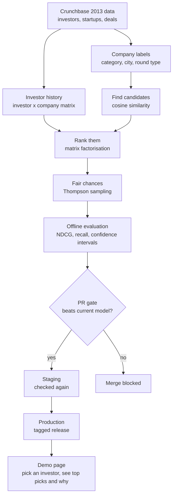
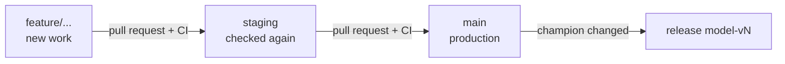

# ML Recommendation Engine

A startup recommender for investors, with **CI/CD for models**.

Given an investor, it suggests the startups they are most likely to back, based on what they have backed before. Every change to the model has to prove itself: a pull request retrains the model on a sample and scores it on held-out data, and the merge is blocked unless the new model beats the current one. Like a team that only starts a new player if he beats the current starter in practice.

> **Status:** champion **model v2** (`label_similarity_full`) is served by a local web API: picks with an exact why and a hindsight check. Next up: Phase 8b, the demo page. See the [roadmap](#roadmap).

---

## How it works



Where the maths lives (each piece must do a real job):

- **Linear algebra:** investor and company vectors, cosine similarity to find candidates fast, matrix factorisation on the investment history.
- **Calculus:** gradient descent, with every gradient derived by hand and checked numerically.
- **Probability:** Thompson sampling, so small or unknown companies still get a fair chance to be seen.
- **Statistics:** confidence intervals on every evaluation score, to know whether "better" is real or just luck.

Rule: the core maths is written in NumPy, then tested against a trusted library to prove it is correct.

---

## How it is evaluated

1. Split every deal at one cutoff date, **1 January 2012**. Deals before it are for training, deals after it are hidden.
2. Ask the model to rank companies for each investor, using only what happened before the cutoff.
3. A good model ranks the hidden companies near the top.

A single cutoff date (not a random split) stops the model from peeking at the future.

**Current numbers (Phase 1):**

- 28,614 training pairs, 5,878 hidden test pairs, 828 test investors.
- 73% of hidden test deals involve a **brand new company** that never appears in training.
- **Limit:** only investors with 5+ deals before 2012 are tested. 4,312 newer investors are left out, so results describe established investors, not first-timers.

Metrics: **NDCG@k** and **recall@k** at **k = 10**, with 95% bootstrap confidence intervals. Every model must beat two simple baselines, **random** and **most popular**.

- **Draft board:** each investor's model ranks the 4,693 companies that raised money on or after the cutoff, minus companies they already backed.
- Scores are reported **overall**, for **known** companies (seen before 2012) and for **new** companies (never seen before 2012).
- A win only counts when the paired confidence interval on the difference is entirely above zero.

**Baseline scoreboard (Phase 2), NDCG@10:**

- Random: 0.0020 (95% CI 0.0007 to 0.0035). The maths predicts random recall@10 of about 0.0021, and the measured 0.0025 agrees.
- Most popular: 0.0055 (95% CI 0.0031 to 0.0083). A real win over random overall and on known companies.
- Most popular scores **exactly 0 on new companies**: known companies always outrank them, so it can never recommend a new startup. 73% of real deals were new startups. This is the gap the next models must close.

**Phase 3, label similarity, NDCG@10:**

- Every company becomes a one-hot checklist of its **category and state**. Every investor becomes the sum of the checklists of their pre-2012 deals. Each startup is scored by cosine similarity to the investor.
- Overall: **0.0171** (95% CI 0.0123 to 0.0222), about 3 times most popular. A real win over both baselines.
- New companies: **0.0172**, a real win over random and most popular (which scores 0). This closes the cold start gap.
- Known companies: a tie with most popular (difference could be luck).
- **Leak check:** with labels shuffled between companies, the score collapses to 0.0005, around random. The signal comes from the real labels.

**Phase 4, matrix factorisation and hybrid, NDCG@10 (current starter: label similarity):**

- **Matrix factorisation:** learned investor and startup profiles, with startup profiles built from label profiles plus a personal profile, so new startups are covered. Trained with the pairwise ranking loss (BPR) and hand-written gradients, checked numerically. Settings chosen on a practice split inside the training years.
  - Overall 0.0172, a tie with label similarity. Much better on known startups (0.0207 vs 0.0088), worse on new (0.0119 vs 0.0172). **Not promoted.**
- **Hybrid:** 0.8 x matrix factorisation + 0.2 x label similarity (standardised scores, weight chosen on the practice split).
  - Overall 0.0203, the best on paper, but the paired CI against label similarity (-0.0016 to +0.0080) crosses zero, so the win is not proven. **Not promoted.**
- Both stay in the code with their losses recorded as visible tests. This is the quality gate idea working: a model that looked better was blocked because its win was not proven.

**Phase 5, fair chances (Thompson sampling):**

- **Exposure check** (now reported for every model): the share of top-10 slots given to new startups, against their 67% share of the board, and how many different startups are ever shown.
  - Most popular: 0%, and it shows the same 15 startups to everyone. Label similarity: 72%, 2,188 different startups. Matrix factorisation: 27%. Hybrid: 22%.
- The starter is already fair, so Thompson sampling was given a real job: make the **hybrid** fair to new startups. A simplified version: a random wobble on each score, sized strength / sqrt(1 + deals), so less-known startups get bigger wobbles. Strength chosen on the practice split (0.25).
- Result: NDCG@10 overall **0.0215**, the highest so far. New startups' share rose from 22% to **64%**, and different startups shown from 1,671 to 2,869.
- Two near misses: 64% is just under the 67% fairness bar, and the win over label similarity (+0.0044, CI -0.0002 to +0.0094) is not proven. **Not promoted.**
- **Lesson:** with one test period and 828 investors, the scoreboard can only prove gains above about 0.005. The next step strengthens the scoreboard itself.

**Phase 5b, multi-season scoreboard (one game vs a playoff series):**

- Four seasons, with cutoffs 1 Jan 2009, 2010, 2011 and 2012. Each season learns only from deals before its cutoff, is tested on the 12 months after it, and reruns the same tuning recipe on the year just before its cutoff. **The recipe is frozen, the practice year moves.**
- 467 to 732 test investors per season, 2,346 investor-seasons in total. One investor can play in several seasons, so the combined interval resamples whole investors (a cluster bootstrap), not single rows. Otherwise the interval would look tighter than the evidence is.
- The 2012 season overlaps the test we already looked at while choosing models, so the verdict is also given on the fresh seasons (2009 to 2011) alone.
- **Result:** Thompson on the hybrid vs label similarity, NDCG@10 overall: **+0.0012** over all seasons (CI -0.0029 to +0.0053), **+0.0023** on the fresh seasons (CI -0.0028 to +0.0073). Could be luck. **Not promoted.** The +0.0044 edge from Phase 5 mostly shrank when replayed.
- What held up across seasons: Thompson really beats the plain hybrid on new startups (+0.0084, real win) and really loses on known (-0.0119). Matrix factorisation alone really loses to label similarity overall (-0.0053). The tuning recipe picked strength 0.25 in every season.
- **Lesson:** even four seasons only prove gains of about 0.004 or more here. Label similarity is a tough starter to beat, and the next real gains probably need new information (Version 2: company descriptions), not more tuning.

**Phase 6, explain each pick:**

- Only the starter (label similarity) is explained, because it is the only model a user would see. A startup has at most two labels, so its score splits **exactly** into a category part and a state part, like a box score: the parts must add up to the total.
- Example: *"Web startup in CA. Matches your CA deals (7, e.g. BookTour, Cirtas Systems) and your web deals (5, e.g. Amie Street, Bill Me Later). CA counts for about 58% of the match."*
- Checked on all 8,280 top-10 picks (828 investors): the parts add up to the model's score (biggest error 1e-16), every cited company is a real past deal from before the cutoff that shares the label, and the biggest reason comes first. None of the picks needed the "shown by chance" label.
- **Finding:** startups missing a label (usually the category) are 2% of the board but **36% of the picks**. With one tick instead of two, their checklist is shorter, so a single match is not diluted and scores high (for example 0.909 for a CA-only startup shown to a CA-heavy investor). The explanations made this bias visible. It is not fixed here: changing the starter needs its own pass marks and a scoreboard run.


**Phase 7, the quality gate (tryout rules posted before anyone plays):**

- The champion lives in [`backend/champion.json`](backend/champion.json), now `{"champion": "label_similarity_full", "version": 2}`. To promote a model, open a PR that changes it and bumps the version by one.
- The `quality-gate` CI job runs on every PR. If the champion did not change, it passes in seconds. If it did, the multi-season scoreboard judges the challenger under three rules, agreed before any challenger was judged:
  1. **Proven win:** over all four seasons, the CI for (challenger minus champion) sits entirely above zero, and it is not a real loss on the fresh seasons.
  2. **Fair to new startups:** in every season, its share of top-10 slots for new startups is at most 5 points below the champion's. Relative, because the champion itself sits a little below the board share.
  3. **Explainable:** it comes with an exact explainer that passes the Phase 6 checks.
- On `main`, a champion change is judged again and then tagged as a GitHub release (`model-v1`, `model-v2`, ...) with the gate report as its notes.
- Checked: the gate blocks every recorded loser for the right reasons (matrix factorisation and the hybrid on all three rules, Thompson on the hybrid on rules 1 and 3), and it **can say yes**: a cheat that peeks at the answers passes rule 1. A referee who never says yes proves nothing.

**Phase 7b, the gate's first real challenger: the missing-label fix:**

- `label_similarity_full`: the same as label similarity, but every startup is divided by the full two-label length, so a missing label counts as a **non-match** instead of quietly shortening the checklist. Fully labelled startups score exactly as before; a startup missing one label scores its old score divided by the square root of 2 (0.909 becomes 0.643).
- Its own pass marks, written before the run, all met: identical scores for fully labelled startups; missing-label picks fall from **36% to 0%** (target: under 10%); its explainer passes all five Phase 6 checks; nothing else breaks.
- **The gate's verdict: PASSED.** Proven win +0.0008 NDCG@10 over all seasons (CI +0.0001 to +0.0015); fresh seasons +0.0006 (CI -0.0000 to +0.0012, not a loss). Fair: at most 4 points below the champion's new-startup share (the rule allows 5). Explainable.
- **Honest reading:** the win is real but **small** (about 3% of the score). It can be proven at this size because the two models disagree on only a few picks, so the paired differences are low-noise. It passes two rules with thin margins, and it overshoots: missing-label startups are now 0% of picks against 2% of the board. The fix was designed after looking at 2012 explanations, which is why the gate also checks the fresh seasons.

**Phase 8a, the API:**

- `GET /picks?investor=...&k=10` returns the champion's picks, each with its score, its exact why, and a **hindsight check**: did this investor really back the startup after the cutoff? `GET /investors?search=...` finds investor ids; `GET /champion` says which model is serving.
- The API reads `champion.json` at startup, so it always serves whatever the gate last crowned, and it refuses to serve a model without an exact explainer.
- Pass marks, all met: the same picks and scores as the scoreboard for all 828 test investors; every why adds up; it follows `champion.json`; bad input gets a plain 404 or 422, never a 500; picks in under a second.
- **What it shows honestly:** for a big investor like Sequoia Capital (184 past deals), the top picks often share **the same score and the same reason** ("software startup in CA"), because a model that only reads two labels cannot tell those startups apart. Their order comes from the random tie-break. That is the ceiling of a label-only model, and the reason for Version 2 (company descriptions).
- Runs locally only. Hosting it publicly could cost money and is a separate decision.

Pass marks are written down **before** each run, and failures are reported honestly in this README.


---

## Data

This project uses the **Crunchbase 2013 Snapshot © 2013**, from the October 2013 export ([source mirror](https://github.com/datahoarder/crunchbase-october-2013)), licensed under [Creative Commons Attribution (CC-BY)](https://creativecommons.org/licenses/by/4.0/). Data from [Crunchbase](https://www.crunchbase.com).

- This export predates Crunchbase's December 2013 switch to a non-commercial licence, so CC-BY applies.
- Newer Crunchbase data is **not** used.
- Version 1 uses company category labels only. Company descriptions arrive in Version 2.
- The files are committed in [`backend/data/raw/`](backend/data/raw/SOURCE.md) with SHA-256 fingerprints. The loader refuses to run if a single byte changes.
- The files are Mac Roman encoded, and a few names were already garbled in the source. See [SOURCE.md](backend/data/raw/SOURCE.md).

Only public data is used in this project.

---

## Project layout

```
ML-Recommendation-engine/
├── README.md
├── LICENSE                 MIT, covers the code only
├── docs/decisions.md       why we chose what we chose
├── docs/session-log.md     what each working session did, and where we stopped
├── .github/workflows/      CI: tests and the quality gate on every PR, a release when the champion changes
├── backend/                Python: data, maths, models, API
│   ├── champion.json       the current champion and its version
│   ├── recommender/
│   │   ├── data/           Phase 1: load, clean, split
│   │   ├── maths/          ALL the maths, one job per file (ranking metrics, confidence intervals, cosine similarity, ranking loss, score scaling)
│   │   ├── models/         uses the maths to make picks (baselines, label similarity, matrix factorisation, hybrid)
│   │   ├── evaluation/     the referee: draft board, scoreboard, multi-season scoreboard, and tuning on a practice split
│   │   ├── explain/        Phase 6: an exact "why" for each pick of the starter
│   │   ├── gate/           Phase 7: the quality gate rules and the release check
│   │   └── api/            Phase 8a: the web API that serves the champion's picks
│   └── tests/              one test file per maths file
└── frontend/               TypeScript (Node.js) demo page, Phase 8
```

Folders are created in the phase they belong to, so nothing here is an empty placeholder.

---

## Branch workflow



- **`feature/...`**: every new piece of work starts here.
- **`staging`**: merged features are checked again here.
- **`main`**: production. Changes only arrive from `staging`, and releases are tagged.
- Nothing is pushed until it is proven to work. Every PR must pass CI.
- `main` and `staging` are **protected**: no direct pushes, the `backend-tests` and `quality-gate` CI checks must pass before merging, and nobody can bypass these rules (the owner included). Force pushes and branch deletion are blocked.

---

## Roadmap

- [x] **0 · Setup:** repo, README, tests on every PR. *Done when one smoke test passes on GitHub Actions on a PR.*
- [x] **1 · Data:** load, clean, split at 1 Jan 2012. *All 5 pass marks met.*
- [x] **2 · Scoreboard:** baselines, NDCG, recall, confidence intervals. *All 5 pass marks met.*
- [x] **3 · Find candidates:** label vectors and cosine similarity. *All pass marks met, plus a shuffled-label leak check.*
- [x] **4 · Rank:** matrix factorisation with hand-written gradients, plus a hybrid. *Neither proved a win over label similarity, so neither was promoted.*
- [x] **5 · Fair chances:** exposure check, plus Thompson sampling on the hybrid. *Fairer and the highest score so far, but two near misses, so not promoted.*
- [x] **5b · Multi-season scoreboard:** four seasons, combined with a cluster bootstrap. *Pass marks for leaks, season size and repeatability met; Thompson's edge over label similarity not proven, so not promoted.*
- [x] **6 · Explain:** an honest "why" for each pick. *All 5 pass marks met; found that startups missing a label are over-picked (2% of the board, 36% of picks).*
- [x] **7 · Quality gate:** PR gate, staging, tagged release. *All 5 pass marks met: blocks every recorded loser, can say yes to a planted winner, tags only when the champion changes.*
- [x] **7b · First challenger:** the missing-label fix. *Passed the gate (small but proven win), becomes model v2.*
- [x] **8a · API:** picks from the champion, each with an exact why and a hindsight check. *All 5 pass marks met.*
- [ ] **8b · Demo page:** TypeScript page on top of the API.
- [ ] **9 · Version 2:** company descriptions, TF-IDF and embeddings.

---

## Running it locally

Requires Python 3.12.

```bash
cd backend
python -m venv .venv
source .venv/bin/activate
pip install -r requirements.txt
pytest -v

# Print the Phase 1 data report
python -m recommender.data.build_dataset

# Print the scoreboard for every model
python -m recommender.evaluation.scoreboard

# Print the multi-season scoreboard (four seasons, about 2 to 3 minutes)
python -m recommender.evaluation.seasons

# Explain every top-10 pick, with checks and three examples (champion v1, or the v2 model)
python -m recommender.explain.report
python -m recommender.explain.report label_similarity_full

# Start the API, then open http://127.0.0.1:8000/docs to try it
uvicorn recommender.api.app:app --reload

# Run the quality gate exactly as CI does (base = the champion.json on the target branch)
python -m recommender.gate --base old-champion.json --head champion.json --report gate-report.md
```

---

## Licence

Code: [MIT](LICENSE), © 2026 Denzel Chingodza.
Data: Crunchbase 2013 Snapshot © 2013, CC-BY (see [Data](#data)).

This is a personal project, built with public data only.
