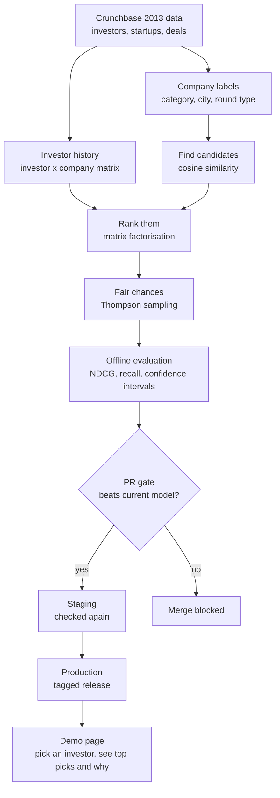
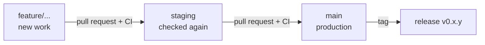

# ML Recommendation Engine

A startup recommender for investors, with **CI/CD for models**.

Given an investor, it suggests the startups they are most likely to back, based on what they have backed before. Every change to the model has to prove itself: a pull request retrains the model on a sample and scores it on held-out data, and the merge is blocked unless the new model beats the current one. Like a team that only starts a new player if he beats the current starter in practice.

> **Status:** Phase 0 (setup) in progress. See the [roadmap](#roadmap).

---

## How it works



Where the maths lives (each piece must do a real job):

- **Linear algebra:** investor and company vectors, cosine similarity to find candidates fast, matrix factorisation on the investment history.
- **Calculus:** gradient descent, with every gradient derived by hand and checked numerically.
- **Probability:** Thompson sampling, so small or unknown companies still get a fair chance to be seen.
- **Statistics:** confidence intervals on every evaluation score, to know whether "better" is real or just luck.

Rule: the core maths is written in NumPy, then tested against a trusted library to prove it is correct.

---

## How it is evaluated

1. Hide some of each investor's real investments.
2. Ask the model to rank companies for that investor.
3. A good model ranks the hidden companies near the top.

Metrics: **NDCG@k** and **recall@k**, with confidence intervals. Every model must beat two simple baselines, **random** and **most popular**.

Pass marks are written down **before** each run, and failures are reported honestly in this README.

---

## Data

This project uses the **Crunchbase 2013 Snapshot © 2013**, from the October 2013 export ([source mirror](https://github.com/datahoarder/crunchbase-october-2013)), licensed under [Creative Commons Attribution (CC-BY)](https://creativecommons.org/licenses/by/4.0/). Data from [Crunchbase](https://www.crunchbase.com).

- This export predates Crunchbase's December 2013 switch to a non-commercial licence, so CC-BY applies.
- Newer Crunchbase data is **not** used.
- Version 1 uses company category labels only. Company descriptions arrive in Version 2.

Only public data is used in this project.

---

## Project layout

```
ML-Recommendation-engine/
├── README.md
├── LICENSE                 MIT, covers the code only
├── docs/decisions.md       why we chose what we chose
├── .github/workflows/      CI: runs tests on every PR
├── backend/                Python: data, maths, models, API
│   ├── recommender/
│   │   ├── data/           Phase 1
│   │   ├── maths/          ALL the maths, one job per file (Phases 2 to 5)
│   │   ├── models/         uses the maths to make picks
│   │   └── api/            Phase 8
│   └── tests/              one test file per maths file
└── frontend/               TypeScript (Node.js) demo page, Phase 8
```

Folders are created in the phase they belong to, so nothing here is an empty placeholder.

---

## Branch workflow



- **`feature/...`**: every new piece of work starts here.
- **`staging`**: merged features are checked again here.
- **`main`**: production. Changes only arrive from `staging`, and releases are tagged.
- Nothing is pushed until it is proven to work. Every PR must pass CI.

---

## Roadmap

- [ ] **0 · Setup:** repo, README, tests on every PR. *Done when one smoke test passes on GitHub Actions on a PR.*
- [ ] **1 · Data:** load, clean, hide some deals for testing.
- [ ] **2 · Scoreboard:** baselines, NDCG, recall, confidence intervals.
- [ ] **3 · Find candidates:** cosine similarity.
- [ ] **4 · Rank:** matrix factorisation with hand-written gradients.
- [ ] **5 · Fair chances:** Thompson sampling.
- [ ] **6 · Explain:** an honest "why" for each pick.
- [ ] **7 · Quality gate:** PR gate, staging, tagged release.
- [ ] **8 · Demo:** API and frontend page.
- [ ] **9 · Version 2:** company descriptions, TF-IDF and embeddings.

---

## Running it locally

Requires Python 3.12.

```bash
cd backend
python -m venv .venv
source .venv/bin/activate
pip install -r requirements.txt
pytest -v
```

---

## Licence

Code: [MIT](LICENSE), © 2026 Denzel Chingodza.
Data: Crunchbase 2013 Snapshot © 2013, CC-BY (see [Data](#data)).

This is a personal project, built with public data only.
