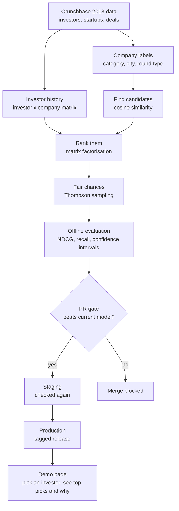
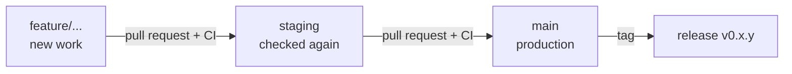

# ML Recommendation Engine

A startup recommender for investors, with **CI/CD for models**.

Given an investor, it suggests the startups they are most likely to back, based on what they have backed before. Every change to the model has to prove itself: a pull request retrains the model on a sample and scores it on held-out data, and the merge is blocked unless the new model beats the current one. Like a team that only starts a new player if he beats the current starter in practice.

> **Status:** Phase 4 (matrix factorisation) done: no promotion, label similarity stays the starter. Next up: Phase 5 (fair chances). See the [roadmap](#roadmap).

---

## How it works



Where the maths lives (each piece must do a real job):

- **Linear algebra:** investor and company vectors, cosine similarity to find candidates fast, matrix factorisation on the investment history.
- **Calculus:** gradient descent, with every gradient derived by hand and checked numerically.
- **Probability:** Thompson sampling, so small or unknown companies still get a fair chance to be seen.
- **Statistics:** confidence intervals on every evaluation score, to know whether "better" is real or just luck.

Rule: the core maths is written in NumPy, then tested against a trusted library to prove it is correct.

---

## How it is evaluated

1. Split every deal at one cutoff date, **1 January 2012**. Deals before it are for training, deals after it are hidden.
2. Ask the model to rank companies for each investor, using only what happened before the cutoff.
3. A good model ranks the hidden companies near the top.

A single cutoff date (not a random split) stops the model from peeking at the future.

**Current numbers (Phase 1):**

- 28,614 training pairs, 5,878 hidden test pairs, 828 test investors.
- 73% of hidden test deals involve a **brand new company** that never appears in training.
- **Limit:** only investors with 5+ deals before 2012 are tested. 4,312 newer investors are left out, so results describe established investors, not first-timers.

Metrics: **NDCG@k** and **recall@k** at **k = 10**, with 95% bootstrap confidence intervals. Every model must beat two simple baselines, **random** and **most popular**.

- **Draft board:** each investor's model ranks the 4,693 companies that raised money on or after the cutoff, minus companies they already backed.
- Scores are reported **overall**, for **known** companies (seen before 2012) and for **new** companies (never seen before 2012).
- A win only counts when the paired confidence interval on the difference is entirely above zero.

**Baseline scoreboard (Phase 2), NDCG@10:**

- Random: 0.0020 (95% CI 0.0007 to 0.0035). The maths predicts random recall@10 of about 0.0021, and the measured 0.0025 agrees.
- Most popular: 0.0055 (95% CI 0.0031 to 0.0083). A real win over random overall and on known companies.
- Most popular scores **exactly 0 on new companies**: known companies always outrank them, so it can never recommend a new startup. 73% of real deals were new startups. This is the gap the next models must close.

**Phase 3, label similarity, NDCG@10:**

- Every company becomes a one-hot checklist of its **category and state**. Every investor becomes the sum of the checklists of their pre-2012 deals. Each startup is scored by cosine similarity to the investor.
- Overall: **0.0171** (95% CI 0.0123 to 0.0222), about 3 times most popular. A real win over both baselines.
- New companies: **0.0172**, a real win over random and most popular (which scores 0). This closes the cold start gap.
- Known companies: a tie with most popular (difference could be luck).
- **Leak check:** with labels shuffled between companies, the score collapses to 0.0005, around random. The signal comes from the real labels.

**Phase 4, matrix factorisation and hybrid, NDCG@10 (current starter: label similarity):**

- **Matrix factorisation:** learned investor and startup profiles, with startup profiles built from label profiles plus a personal profile, so new startups are covered. Trained with the pairwise ranking loss (BPR) and hand-written gradients, checked numerically. Settings chosen on a practice split inside the training years.
  - Overall 0.0172, a tie with label similarity. Much better on known startups (0.0207 vs 0.0088), worse on new (0.0119 vs 0.0172). **Not promoted.**
- **Hybrid:** 0.8 x matrix factorisation + 0.2 x label similarity (standardised scores, weight chosen on the practice split).
  - Overall 0.0203, the best on paper, but the paired CI against label similarity (-0.0016 to +0.0080) crosses zero, so the win is not proven. **Not promoted.**
- Both stay in the code with their losses recorded as visible tests. This is the quality gate idea working: a model that looked better was blocked because its win was not proven.


Pass marks are written down **before** each run, and failures are reported honestly in this README.

---

## Data

This project uses the **Crunchbase 2013 Snapshot © 2013**, from the October 2013 export ([source mirror](https://github.com/datahoarder/crunchbase-october-2013)), licensed under [Creative Commons Attribution (CC-BY)](https://creativecommons.org/licenses/by/4.0/). Data from [Crunchbase](https://www.crunchbase.com).

- This export predates Crunchbase's December 2013 switch to a non-commercial licence, so CC-BY applies.
- Newer Crunchbase data is **not** used.
- Version 1 uses company category labels only. Company descriptions arrive in Version 2.
- The files are committed in [`backend/data/raw/`](backend/data/raw/SOURCE.md) with SHA-256 fingerprints. The loader refuses to run if a single byte changes.
- The files are Mac Roman encoded, and a few names were already garbled in the source. See [SOURCE.md](backend/data/raw/SOURCE.md).

Only public data is used in this project.

---

## Project layout

```
ML-Recommendation-engine/
├── README.md
├── LICENSE                 MIT, covers the code only
├── docs/decisions.md       why we chose what we chose
├── docs/session-log.md     what each working session did, and where we stopped
├── .github/workflows/      CI: runs tests on every PR
├── backend/                Python: data, maths, models, API
│   ├── recommender/
│   │   ├── data/           Phase 1: load, clean, split
│   │   ├── maths/          ALL the maths, one job per file (ranking metrics, confidence intervals, cosine similarity, ranking loss, score scaling)
│   │   ├── models/         uses the maths to make picks (baselines, label similarity, matrix factorisation, hybrid)
│   │   ├── evaluation/     the referee: draft board, scoreboard, and tuning on a practice split
│   │   └── api/            Phase 8
│   └── tests/              one test file per maths file
└── frontend/               TypeScript (Node.js) demo page, Phase 8
```

Folders are created in the phase they belong to, so nothing here is an empty placeholder.

---

## Branch workflow



- **`feature/...`**: every new piece of work starts here.
- **`staging`**: merged features are checked again here.
- **`main`**: production. Changes only arrive from `staging`, and releases are tagged.
- Nothing is pushed until it is proven to work. Every PR must pass CI.
- `main` and `staging` are **protected**: no direct pushes, the `backend-tests` CI check must pass before merging, and nobody can bypass these rules (the owner included). Force pushes and branch deletion are blocked.

---

## Roadmap

- [x] **0 · Setup:** repo, README, tests on every PR. *Done when one smoke test passes on GitHub Actions on a PR.*
- [x] **1 · Data:** load, clean, split at 1 Jan 2012. *All 5 pass marks met.*
- [x] **2 · Scoreboard:** baselines, NDCG, recall, confidence intervals. *All 5 pass marks met.*
- [x] **3 · Find candidates:** label vectors and cosine similarity. *All pass marks met, plus a shuffled-label leak check.*
- [x] **4 · Rank:** matrix factorisation with hand-written gradients, plus a hybrid. *Neither proved a win over label similarity, so neither was promoted.*
- [ ] **5 · Fair chances:** Thompson sampling.
- [ ] **6 · Explain:** an honest "why" for each pick.
- [ ] **7 · Quality gate:** PR gate, staging, tagged release.
- [ ] **8 · Demo:** API and frontend page.
- [ ] **9 · Version 2:** company descriptions, TF-IDF and embeddings.

---

## Running it locally

Requires Python 3.12.

```bash
cd backend
python -m venv .venv
source .venv/bin/activate
pip install -r requirements.txt
pytest -v

# Print the Phase 1 data report
python -m recommender.data.build_dataset

# Print the scoreboard for every model
python -m recommender.evaluation.scoreboard
```

---

## Licence

Code: [MIT](LICENSE), © 2026 Denzel Chingodza.
Data: Crunchbase 2013 Snapshot © 2013, CC-BY (see [Data](#data)).

This is a personal project, built with public data only.
